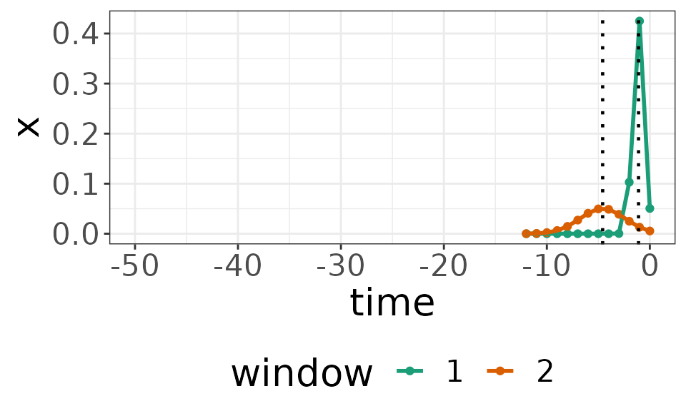
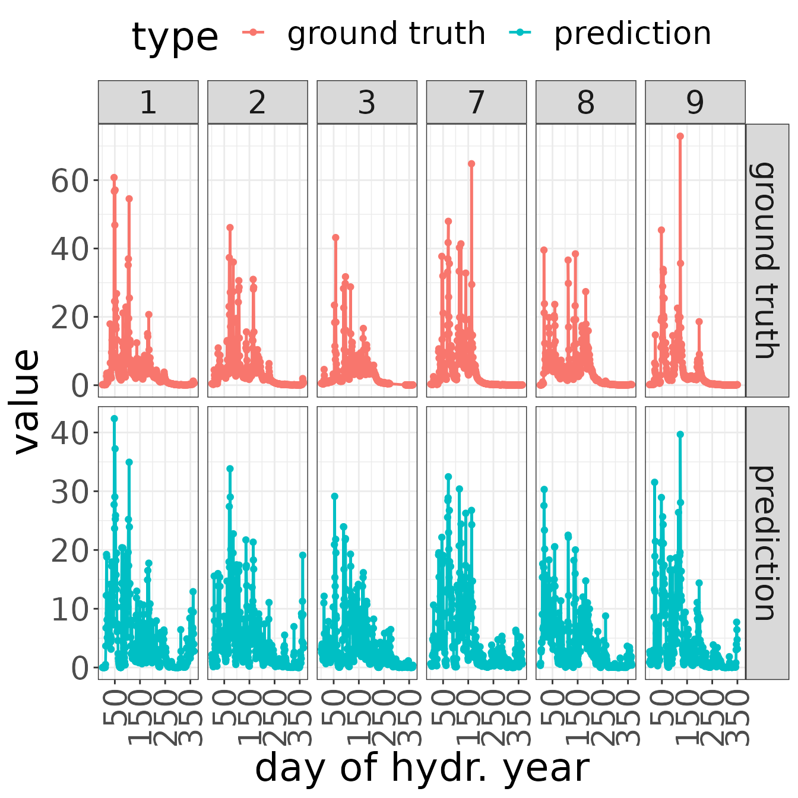

# Sample experiment using Sliding Window Regression

## Introduction

`SlidingWindowReg` implements a regression model for hydrological time
series data. In particular, multiple time-lagged windows with Gaussian
kernel shape are estimated from training data. Then, each extracted
feature is mapped to a target time series via multiple linear
regression.

In this vignette, a sample experiment is performed to demonstrate that
the model is able to identify model parameters correctly in a
user-simulated setup.

### Data preparation & experimental setup

First, we load the package and the sample watershed data:

``` r

library(SlidingWindowReg)

data("sampleWatershed")
```

As a second step, we divide the dataset into (a) a train set containing
30 years (77% of the time series) and (b) a test set comprising the
residual 9 years (23% of the time series). Note that in the present
dataset, *years* refer to hydrological years (October 01 to September
30).

``` r

library(lubridate) # package to handle date formats
```

    ## 
    ## Attaching package: 'lubridate'

    ## The following objects are masked from 'package:base':
    ## 
    ##     date, intersect, setdiff, union

``` r

hydr_year <- cumsum(format(sampleWatershed$date, "%d.%m.") == "01.10.") # determine hydrological years (Oct 01 to Sep 30)

train_inds <- which(hydr_year <= 30)
```

## SlidingWindowReg model

Given the data splits, we train the `SlidingWindowReg` model on the
train set. For this purpose, the following parameters are set:

- `iter` number of iterations (maximum number of windows)
- `runs` number of independent model runs — by default, the run
  achieving the best performance metric is returned
- `param_selection` method to determine the number of windows

### Model training

In the presented example, we use 3 iterations (up to 3 windows), and
determine the hyperparameter (number of windows $`k`$) with respect to
the Bayesian Information Criterion (BIC).% Further, we set the
parallelization procedure to `FALSE`.

``` r

mod <- trainSWR(sampleWatershed$rain[train_inds],
                sampleWatershed$gauge[train_inds],
                iter = 3,
                param_selection = "best_bic")
```

    ## Warning: The `runs` argument of `trainSWR()` is deprecated as of SlidingWindowReg 0.1.1.
    ## ℹ Multiple model runs are not useful with deterministic window initializations.
    ## This warning is displayed once per session.
    ## Call `lifecycle::last_lifecycle_warnings()` to see where this warning was
    ## generated.

    ## Warning: The `parallel` argument of `trainSWR()` is deprecated as of SlidingWindowReg
    ## 0.1.1.
    ## ℹ Parallel model runs are not useful with deterministic window initializations.
    ## This warning is displayed once per session.
    ## Call `lifecycle::last_lifecycle_warnings()` to see where this warning was
    ## generated.

    ## Warning: The `return` argument of `trainSWR()` is deprecated as of SlidingWindowReg
    ## 0.1.1.
    ## ℹ Return argument is unused.
    ## This warning is displayed once per session.
    ## Call `lifecycle::last_lifecycle_warnings()` to see where this warning was
    ## generated.

The optimizer GENOUD (Genetic optimization using derivatives) is used by
default. Alternatively, the package supports derivative-free
optimization as well: the `algorithm` argument can be set to
`algorithm = “BOBYQA”`.

``` r

mod_BOBYQA <- trainSWR(sampleWatershed$rain[train_inds],
                sampleWatershed$gauge[train_inds],
                iter = 3,
                param_selection = "best_bic",
                algorithm = "BOBYQA")
```

%## Parallelization

%Model parallelization is implemented between the model runs, while
iterations (incrementally adding windows in each iterations) run in a
%serial order. Hence, the option `parallel = FALSE` should be chosen if
`runs = 1`. In case of multiple model runs, %`parallel` can be set to
either `TRUE` (in this case, the number of available kernels is
determined automatically), or to a %positive integer number indicating
the number of kernels to be used.

## Evaluation

Tools for evaluating the model results include summary and plot
functions for the model parameters, as well as metrics and plots to
determine the predictive performance on test sets.

### Model parameters

A first overview on the model results can be obtained by printing a
model summary:

``` r

summary(mod)
```

    ## SlidingWindowReg (SWR) model object with k = 3 windows
    ## 
    ## | window| delta| sigma| beta|
    ## |------:|-----:|-----:|----:|
    ## |      1|  1.32|  0.17| 0.44|
    ## |      2|  1.72|  3.55| 0.33|
    ## |      3| 29.02| 14.66| 0.13|

In specific, the main model parameters are stored as:

- a matrix characterizing the location and size of the windows (column 1
  indicates all center points on the time axis, column 2 indicates the
  variance)
- a vector of regression coefficients

``` r

# window parameters
print(mod$param)
```

    ##          delta      sigma
    ## [1,]  1.318546  0.1666667
    ## [2,]  1.720308  3.5465938
    ## [3,] 29.019943 14.6590593

``` r

# regression parameters
print(mod$mix)
```

    ## [1] 0.4413509 0.3311588 0.1321360

In order to visualize the estimated windows, a kernel plot is available
in `SlidingWindowReg`:

``` r

coef(mod)
```

    ##                                                                         
    ## kernel1 0.000000e+00 0.000000e+00 0.000000e+00 0.000000e+00 0.000000e+00
    ## kernel2 0.000000e+00 0.000000e+00 0.000000e+00 0.000000e+00 0.000000e+00
    ## kernel3 4.093753e-05 5.011433e-05 6.106354e-05 7.405968e-05 8.940492e-05
    ##                                                                         
    ## kernel1 0.0000000000 0.0000000000 0.0000000000 0.0000000000 0.0000000000
    ## kernel2 0.0000000000 0.0000000000 0.0000000000 0.0000000000 0.0000000000
    ## kernel3 0.0001074288 0.0001284872 0.0001529603 0.0001812497 0.0002137744
    ##                                                                        
    ## kernel1 0.0000000000 0.0000000000 0.0000000000 0.0000000000 0.000000000
    ## kernel2 0.0000000000 0.0000000000 0.0000000000 0.0000000000 0.000000000
    ## kernel3 0.0002509654 0.0002932592 0.0003410902 0.0003948814 0.000455034
    ##                                                                        
    ## kernel1 0.0000000000 0.0000000000 0.0000000000 0.000000000 0.0000000000
    ## kernel2 0.0000000000 0.0000000000 0.0000000000 0.000000000 0.0000000000
    ## kernel3 0.0005219161 0.0005958506 0.0006771015 0.000765861 0.0008622354
    ##                                                                                
    ## kernel1 0.0000000000 0.000000000 0.000000000 0.000000000 0.00000000 0.000000000
    ## kernel2 0.0000000000 0.000000000 0.000000000 0.000000000 0.00000000 0.000000000
    ## kernel3 0.0009662322 0.001077747 0.001196554 0.001322291 0.00145446 0.001592415
    ##                                                                              
    ## kernel1 0.000000000 0.000000000 0.000000000 0.000000000 0.00000000 0.00000000
    ## kernel2 0.000000000 0.000000000 0.000000000 0.000000000 0.00000000 0.00000000
    ## kernel3 0.001735364 0.001882368 0.002032348 0.002184096 0.00233628 0.00248747
    ##                                                                               
    ## kernel1 0.000000000 0.000000000 0.000000000 0.000000000 0.00000000 0.000000000
    ## kernel2 0.000000000 0.000000000 0.000000000 0.000000000 0.00000000 0.000000000
    ## kernel3 0.002636153 0.002780758 0.002919681 0.003051318 0.00317409 0.003286478
    ##                                                                               
    ## kernel1 0.000000000 0.000000000 0.000000000 0.000000000 0.000000000 0.00000000
    ## kernel2 0.000000000 0.000000000 0.000000000 0.000000000 0.000000000 0.00000000
    ## kernel3 0.003387053 0.003474506 0.003547675 0.003605574 0.003647411 0.00367261
    ##                                                                                
    ## kernel1 0.000000000 0.000000000 0.000000000 0.000000000 0.000000000 0.000000000
    ## kernel2 0.000000000 0.000000000 0.000000000 0.000000000 0.000000000 0.000000000
    ## kernel3 0.003680821 0.003671929 0.003646058 0.003603568 0.003545043 0.003471284
    ##                                                                                
    ## kernel1 0.000000000 0.000000000 0.000000000 0.000000000 0.000000000 0.000000000
    ## kernel2 0.000000000 0.000000000 0.000000000 0.000000000 0.000000000 0.000000000
    ## kernel3 0.003383285 0.003282212 0.003169382 0.003046227 0.002914269 0.002775088
    ##                                                                    
    ## kernel1 0.00000000 0.000000000 0.000000000 0.000000000 0.0000000000
    ## kernel2 0.00000000 0.000000000 0.000000000 0.000000000 0.0003326608
    ## kernel3 0.00263029 0.002481477 0.002330219 0.002178025 0.0020263239
    ##                                                                     
    ## kernel1 0.0000000000 0.000000000 0.000000000 0.000000000 0.000000000
    ## kernel2 0.0007794072 0.001687411 0.003375763 0.006240499 0.010660162
    ## kernel3 0.0018764395 0.001729577 0.001586811 0.001449073 0.001317149
    ##                                                                     -3
    ## kernel1 0.000000000 0.000000000 0.0000000000 0.0000000000 2.986964e-13
    ## kernel2 0.016826990 0.024544151 0.0330818056 0.0412031624 4.742119e-02
    ## kernel3 0.001191679 0.001073158 0.0009619392 0.0008582451 7.621753e-04
    ##                   -2          -1            0
    ## kernel1 0.0609673766 0.380383291 1.996781e-07
    ## kernel2 0.0504330411 0.049563137 4.500941e-02
    ## kernel3 0.0006737179 0.000592763 5.191154e-04

``` r

plot(mod, include_text = FALSE)
```



### Predictive performance

To assess its predictive performance, we evaluate the model on the test
set. For this purpose, we compute the root mean squared error (RMSE) and
further evaluation metrics:

``` r

pred_on_test <- predict(mod, 
                        newdata = sampleWatershed$rain[-train_inds])

print(eval_all(pred_on_test, 
               sampleWatershed$gauge[-train_inds]))
```

    ##       rmse     nrmse     mape        r2       nse       kge
    ## 1 3.367502 0.8936339 2.580429 0.7221181 0.7221181 0.7178792

As a next step, we generate a plot demonstrating

- the input time series,
- the predicted output time series, and
- the ground truth output.

The plot demonstrates the first 3 and last 3 hydrological years (in this
case, years 1-3 and 7-9 are displayed).

``` r

plot(mod, 
     type = "prediction",
     reference = sampleWatershed$gauge[-train_inds],
     newdata = sampleWatershed$rain[-train_inds])
```


